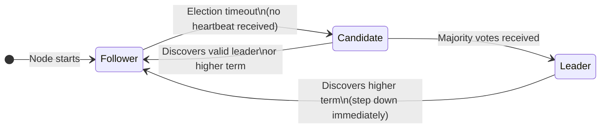
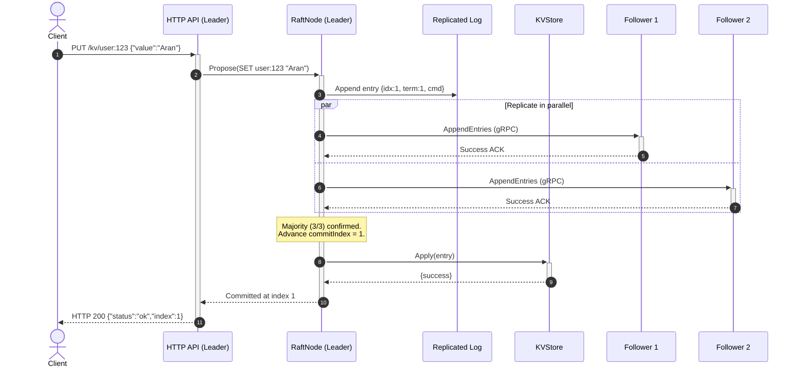
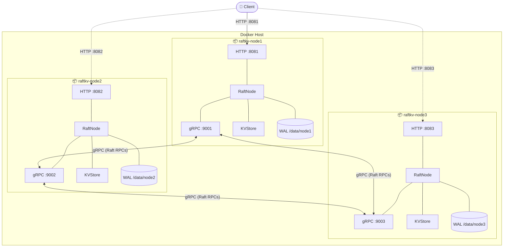

<div align="center">

<h1>
  
  &nbsp; Dynamic Raft KV
</h1>

<h3>A production-grade, fault-tolerant distributed key-value store<br/>built from scratch using the Raft consensus algorithm in Go</h3>

<p>
  <a href="https://github.com/DynamicRaftKV/dynamic-raft-kv/issues"></a>
  <a href="https://github.com/DynamicRaftKV/dynamic-raft-kv/milestones"></a>
  <a href="https://github.com/orgs/DynamicRaftKV/projects/3"></a>
  <a href="LICENSE"></a>
  
  
  
</p>

<p>
  <a href="#-what-is-this">What is this?</a> ·
  <a href="#-architecture">Architecture</a> ·
  <a href="#-quick-start">Quick Start</a> ·
  <a href="#-demo-ui">Demo UI</a> ·
  <a href="#%EF%B8%8F-docker-cluster">Docker Cluster</a> ·
  <a href="#-raft-internals">Raft Internals</a> ·
  <a href="#-api-reference">API Reference</a> ·
  <a href="#-project-roadmap">Roadmap</a> ·
  <a href="#-team">Team</a>
</p>

---

</div>

## 🧠 What is this?

**Dynamic Raft KV** is a distributed, strongly-consistent key-value store built **from scratch in Go** — no Raft libraries, no shortcuts. It is a ground-up implementation of the [Raft consensus algorithm](https://raft.github.io/raft.pdf) as described in the 2014 Ongaro & Ousterhout paper, applied to a practical key-value database.

> **This is not a toy.** It is a 9-stage engineering project targeting production-level correctness, including leader election, log replication, crash recovery, state snapshotting, dynamic cluster membership, fault injection, and full observability.

### ✨ Key Properties

| Property | Description |
|:---|:---|
| **Strong Consistency** | Linearizable reads and writes — all nodes always agree on the same ordered log |
| **Fault Tolerance** | A 3-node cluster tolerates 1 simultaneous failure; a 5-node cluster tolerates 2 |
| **Automatic Leader Failover** | If the leader crashes, a new leader is elected within 150–600ms |
| **Crash Recovery** | WAL + persistent state means a restarted node replays its log and rejoins the cluster |
| **Dynamic Membership** | Nodes can join, leave, or be promoted without downtime (Stages 6+) |
| **Fully Observable** | Prometheus metrics, structured logging, and health endpoints (Stage 7) |

---

## 🏗️ Architecture

The system is a 3-to-5 node cluster where each node runs the same process — an HTTP API, a Raft consensus engine, a state machine (the KV store), and persistent storage. All client writes flow through the elected leader.

### High-Level System View

```
                    ┌────────────────────────────┐
                    │         CLIENTS             │
                    │  (curl / CLI / SDK / HTTP)  │
                    └─────────────┬──────────────┘
                                  │  HTTP/JSON (PUT · GET · DELETE)
                    ┌─────────────▼──────────────┐
                    │       HTTP API LAYER        │
                    │  (per node, port 8081-8083) │
                    └──────────┬─────────────────┘
                               │  Propose(cmd)
          ┌────────────────────┼────────────────────┐
          ▼                    ▼                    ▼
   ┌─────────────┐     ┌─────────────┐     ┌─────────────┐
   │   NODE 1    │     │   NODE 2    │     │   NODE 3    │
   │  ─────────  │     │  ─────────  │     │  ─────────  │
   │  RaftNode   │◄────►  RaftNode  ◄────► │  RaftNode   │
   │  (Leader/   │     │  (Follower) │     │  (Follower) │
   │  Follower)  │     │             │     │             │
   │  ─────────  │     │  ─────────  │     │  ─────────  │
   │  KV Store   │     │  KV Store   │     │  KV Store   │
   │  (map[k]v)  │     │  (map[k]v)  │     │  (map[k]v)  │
   │  ─────────  │     │  ─────────  │     │  ─────────  │
   │  WAL/Disk   │     │  WAL/Disk   │     │  WAL/Disk   │
   └─────────────┘     └─────────────┘     └─────────────┘
         gRPC: AppendEntries & RequestVote (ports 9001-9003)
```

### Component Breakdown

| Component | Role | Technology |
|:---|:---|:---|
| **HTTP API** | Client-facing REST interface. Forwards writes to Raft, redirects clients to leader if needed | Go `net/http` |
| **RaftNode** | Core consensus engine. Manages elections, log replication, heartbeats, and commit tracking | Pure Go |
| **StateMachine / KVStore** | The actual database — a `map[string]string` that receives committed log entries | Go map |
| **Storage / WAL** | Persists `currentTerm`, `votedFor`, and log entries to disk for crash recovery | JSON files on disk |
| **GRPCTransport** | Node-to-node communication for `RequestVote` and `AppendEntries` RPCs | gRPC + Protobuf |

---

## 🔬 Raft Internals

### The Replicated Log

Every node maintains an identical ordered log of commands. A write is **committed** only when a majority of nodes (≥2 of 3) have appended it.

```
Index:   1            2            3            4
       ┌──────────┐  ┌──────────┐  ┌──────────┐  ┌──────────┐
       │ SET      │  │ SET      │  │ DELETE   │  │ SET      │
       │ user:123 │  │ config:x │  │ user:456 │  │ z = 99   │
       │ "Aran"   │  │ "true"   │  │          │  │          │
       │ Term 1   │  │ Term 1   │  │ Term 2   │  │ Term 2   │
       └──────────┘  └──────────┘  └──────────┘  └──────────┘
        ✅ committed  ✅ committed  ✅ committed   🔄 pending
```

### Node State Machine



| State | Behaviour |
|:---:|:---|
| **Follower** | Waits for heartbeats from the leader. Votes in elections. Never accepts writes directly. |
| **Candidate** | Requests votes from peers to become leader. Increments term, votes for itself. |
| **Leader** | Accepts all writes. Replicates entries to followers. Sends heartbeats every ~100ms. |

### Write Path (10 Steps)



### Leader Election

When a follower doesn't receive a heartbeat within a random **election timeout (150–300ms)**, it starts a new election:

1. Increments `currentTerm`, transitions to **Candidate**
2. Votes for itself, sends `RequestVote` to all peers
3. If it receives votes from a **majority** → becomes **Leader**
4. Immediately sends heartbeats to reset all followers' timers

> **Split vote:** If two candidates start simultaneously and neither wins, both wait a new random timeout before retrying. The randomisation ensures one candidate wins quickly.

---

## ⚡ Quick Start

### Prerequisites

- Go 1.27+
- Docker (for cluster mode)
- `protoc` 33.0 (only if regenerating gRPC contracts)

### Build & Test

```sh
# Clone the repository
git clone https://github.com/DynamicRaftKV/dynamic-raft-kv.git
cd dynamic-raft-kv

# Build binaries, vet, run tests, check race conditions
make build vet test race

# Start a single node
./bin/raftkv --node-id node1 --http-addr :8001 --grpc-addr :9001
```

### Configuration

```sh
./bin/raftkv [flags]
```

| Flag | Environment Variable | Default | Description |
|:---|:---|:---:|:---|
| `--node-id` | `RAFTKV_NODE_ID` | `node1` | Unique name for this node |
| `--peers` | `RAFTKV_PEERS` | `""` | Comma-separated peer list: `id=host:port,id=host:port` |
| `--data-dir` | `RAFTKV_DATA_DIR` | `./data` | Directory for WAL and snapshot files |
| `--http-addr` | `RAFTKV_HTTP_ADDR` | `:8001` | Client-facing HTTP address |
| `--grpc-addr` | `RAFTKV_GRPC_ADDR` | `:9001` | Inter-node gRPC address |

---

## 🖥️ Demo UI

A local demo mode is included to showcase the in-memory KV engine, snapshot capture, and architecture overview:

```sh
# Start in demo mode
./bin/raftkv --demo --http-addr 127.0.0.1:8080 --grpc-addr 127.0.0.1:9090

# Or use the Makefile shortcut
make demo
```

Then open **http://127.0.0.1:8080/demo/** in your browser.

> **Note:** The demo UI is for local presentation only. It does **not** implement consensus or replication. Data is held in-memory and lost on restart. Captured snapshots remain in the browser tab until downloaded.

**Demo capabilities:**
- ✅ Interactive `PUT` / `GET` / `DELETE` on the in-memory KV store
- ✅ Live key inspection and value browsing
- ✅ Snapshot capture, download, and restore
- ✅ Implementation progress overview
- ✅ Architecture visualisation panels

---

## 🐳 Docker Cluster

Run a full 3-node Raft cluster locally using Docker Compose:

```sh
# Start a 3-node cluster
docker compose up -d --build

# Add a 4th node
docker compose --profile node4 up -d --build

# Add a 4th and 5th node
docker compose --profile node4 --profile node5 up -d --build

# Add a node to the live cluster
sh scripts/add-node.sh 4

# Tear down (volumes are preserved)
docker compose --profile node4 --profile node5 down
```

### Port Map

| Node | HTTP Port | gRPC Port | Data Volume |
|:---:|:---:|:---:|:---|
| `raftkv-node1` | `:8081` | `:9001` | `/data/node1/` |
| `raftkv-node2` | `:8082` | `:9002` | `/data/node2/` |
| `raftkv-node3` | `:8083` | `:9003` | `/data/node3/` |

### Network Topology



---

## 📡 API Reference

All endpoints use JSON. Write requests must be sent to the **leader**; followers return `HTTP 307` with the leader's address.

### Key-Value Operations

```sh
# Write a key
curl -X PUT http://localhost:8081/kv/user:123 \
  -H "Content-Type: application/json" \
  -d '{"value": "Aran"}'
# → 200 {"status":"ok","index":1,"term":1}

# Read a key
curl http://localhost:8081/kv/user:123
# → 200 {"key":"user:123","value":"Aran","found":true}

# Delete a key
curl -X DELETE http://localhost:8081/kv/user:123
# → 200 {"status":"ok","index":2,"term":1}

# Key not found
curl http://localhost:8081/kv/unknown
# → 404 {"key":"unknown","found":false}
```

### Cluster Status

```sh
curl http://localhost:8081/status
# → 200 {"node_id":"node1","state":"Leader","term":3,"commit_index":42,"leader":"node1"}
```

### Leader Redirect (Follower Behaviour)

```sh
# Client hits a follower
curl -X PUT http://localhost:8082/kv/x '{"value":"1"}'
# → 307 {"leader":"node1:8081"}
# Client retries automatically against the leader
```

---

## 🛠️ Development

### Generating gRPC Contracts

```sh
# Install code generators (exact versions required)
go install google.golang.org/protobuf/cmd/protoc-gen-go@v1.36.10
go install google.golang.org/grpc/cmd/protoc-gen-go-grpc@v1.5.1

# Regenerate from .proto files
make generate

# Verify generated files match committed versions
make check-generated
```

### Running the Linter

```sh
# Requires golangci-lint v2 on PATH
make lint
```

### Tech Stack

| Layer | Technology |
|:---|:---|
| Language | Go 1.27 |
| Consensus | Raft (from-scratch implementation) |
| Transport | gRPC + Protocol Buffers v3 |
| Client API | HTTP/JSON REST |
| Persistence | Write-Ahead Log (WAL) — JSON on disk |
| Containerisation | Docker + Docker Compose |
| Observability | Prometheus metrics (Stage 7) |
| Testing | Go `testing`, race detector, fault injection (Stage 7) |

---

## 🗺️ Project Roadmap

The project is structured as 9 stages, managed on the [GitHub Project Board](https://github.com/orgs/DynamicRaftKV/projects/3):

| Stage | Theme | Key Deliverables | Status |
|:---:|:---|:---|:---:|
| **1** | Foundation & System Design | SDD, Protobuf contracts, core interfaces, ADRs | 🔄 In Progress |
| **2** | Standalone KV Engine | In-memory KV, WAL, state machine, Snapshot/Restore | ✅ Scaffolded |
| **3** | Raft Core | Leader election, AppendEntries, heartbeats, safety proofs | 📋 Ready |
| **4** | Networking & Client | gRPC transport, follower redirect, client SDK, CLI | ⏳ Pending |
| **5** | Durability & Snapshots | Log compaction, InstallSnapshot RPC, crash recovery | ⏳ Pending |
| **6** | Dynamic Membership | Joint consensus, learner nodes, single-server changes | ⏳ Pending |
| **7** | Reliability & Observability | Chaos testing, fault injection, Prometheus dashboards | ⏳ Pending |
| **8** | Integration & Evaluation | End-to-end tests, benchmarks, runbooks, presentation | ⏳ Pending |
| **9** | Stretch Goals | Read leases, pipelining, multi-Raft, TLS | 🔮 Future |

> 📋 View the full breakdown of **39 Epics** and **161 Tasks** on the [**Live Project Board →**](https://github.com/orgs/DynamicRaftKV/projects/3)

---

## 👥 Team

| Person | GitHub | Architectural Domain |
|:---|:---|:---|
| **Anubhav** | [@Anubhav2506](https://github.com/Anubhav2506) | Raft Core — consensus, election, log replication |
| **Eternal-Spirit** | [@Eternal-Spirit](https://github.com/Eternal-Spirit) | Storage & Membership — WAL, snapshots, dynamic membership |
| **Pratik** | [@pratikbatish](https://github.com/pratikbatish) | Networking & API — gRPC transport, client SDK, CLI |
| **Yuvraj** | [@Yuvraj-Kumar05](https://github.com/Yuvraj-Kumar05) | Reliability & DevOps — fault injection, CI/CD, observability |

---

## 📚 Further Reading

| Document | Description |
|:---|:---|
| [📖 Complete Project Guide](raft_kv_complete_guide.md) | 1700-line deep-dive: what is Raft, why it exists, how it works, walkthrough of every scenario |
| [📐 System Design Diagrams](raftkv_diagrams.md) | 6 consistent UML/Mermaid diagrams: class, data flow, use case, sequence, state machine, deployment |
| [📋 Implementation Plan](docs/implementation-plan.md) | Primary specification: all stages, tasks, acceptance criteria |
| [⚖️ Contracts & Interfaces](docs/contracts.md) | Interface decisions and architectural contract decisions |
| [🌐 HTTP API Spec](docs/api.md) | Full HTTP endpoint specification |
| [📸 Snapshot Format](docs/snapshot-format.md) | Binary format of Raft state snapshots |
| [✅ Stage 1 Status](docs/stage1-status.md) | Current implementation status for Stage 1 |
| [✅ Stage 2 Status](docs/stage2-status.md) | Current implementation status for Stage 2 |

---

## 📄 License

This project is licensed under the **MIT License** — see [LICENSE](LICENSE) for details.

---

<div align="center">

Built with ❤️ at **DynamicRaftKV** · 
[Project Board](https://github.com/orgs/DynamicRaftKV/projects/3) ·
[Open Issues](https://github.com/DynamicRaftKV/dynamic-raft-kv/issues) ·
[Milestones](https://github.com/DynamicRaftKV/dynamic-raft-kv/milestones)

</div>
