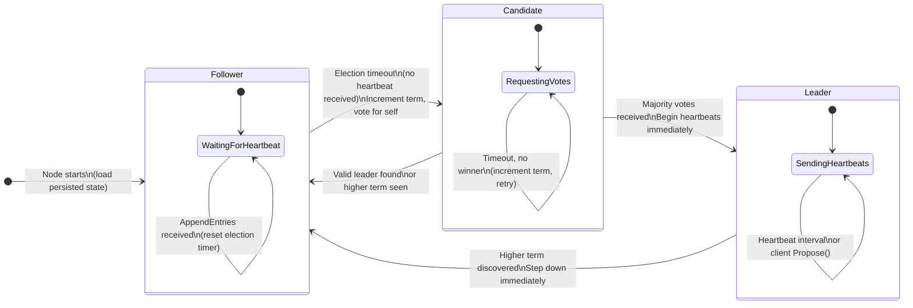
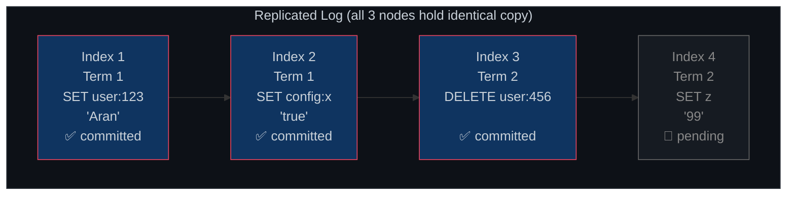

<div align="center">

<h1>
Dynamic Raft KV
</h1>

<h3>A fault-tolerant distributed key-value store — Raft consensus, built from scratch in Go</h3>

<p>
  <a href="https://github.com/DynamicRaftKV/dynamic-raft-kv/issues"></a>
  <a href="https://github.com/DynamicRaftKV/dynamic-raft-kv/milestones"></a>
  <a href="https://github.com/orgs/DynamicRaftKV/projects/3"></a>
  <a href="LICENSE"></a>
  
  
  
</p>

<p>
  <a href="#-what-is-this">What is this?</a> ·
  <a href="#-architecture">Architecture</a> ·
  <a href="#-raft-internals">Raft Internals</a> ·
  <a href="#-quick-start">Quick Start</a> ·
  <a href="#%EF%B8%8F-docker-cluster">Docker Cluster</a> ·
  <a href="#-api-reference">API Reference</a> ·
  <a href="#-project-roadmap">Roadmap</a> ·
  <a href="#-team">Team</a>
</p>

---

</div>

## Current implementation status — 29 October 2026

The standalone KV engine (Stage 2) and fixed-membership Raft core (Stage 3,
phases 3.1–3.4) are implemented and tested. Stage 4 connects the core to HTTP,
gRPC and CLI with real TCP tests for 1, 3, 5 and 7 nodes. The demo remains
memory-only and single-node. Stage 5.1–5.3 adds a synced WAL, durable process
startup using `--cluster-config`, snapshots, chunked transfer and log compaction.
Durable nodes checkpoint every 1000 applied entries by default; configure this
with `--snapshot-entries` (`0` disables periodic capture, not membership checkpoints). See
[snapshot limits and ordering](docs/adr/0007-snapshots-and-compaction.md).
Stage 6 now implements durable joint consensus, learner join/catch-up, promotion
and removal, with core and four-process restart tests. See the
[membership runbook](docs/stage6-status.md). Remote CI and consensus review remain
required; real-cluster Docker/UI integration remains pending. Foundation/interface
review and the required Raft reviews remain open.

See [Stage 3 plan](docs/stage3-plan.md) and [verification and limitations](docs/stage3-status.md).
See also [Stage 4 progress and next steps](docs/stage4-status.md).
The [completion plan](docs/completion-plan.md) lists every remaining stage,
including Docker Compose. [Stage 5 instructions](docs/stage5-status.md) show how
to launch three durable local processes now without Docker.
The architecture, distributed quick-start examples and capability descriptions
below describe the target system, not a currently deployable distributed service.

To exercise the implemented consensus scenarios:

```sh
go test -v ./internal/raft
go test -race ./...
```

For the existing standalone UI, run `make demo` and open
[the local demo](http://127.0.0.1:8080/demo/).
If the binaries are already built, you can restart it directly with
`./bin/raftkv --demo --http-addr 127.0.0.1:8080 --grpc-addr 127.0.0.1:9090`.
Keep that process running; a stopped server makes the page unavailable.

## 🧠 What is this?

**Dynamic Raft KV** is a distributed, strongly-consistent key-value store built **from scratch in Go** — no Raft libraries, no shortcuts. It is a ground-up implementation of the [Raft consensus algorithm](https://raft.github.io/raft.pdf) (Ongaro & Ousterhout, 2014) applied to a practical key-value database.

> **This is not a toy.** It is a 9-stage engineering project targeting production-level correctness: leader election, log replication, crash recovery, state snapshotting, dynamic cluster membership, fault injection, and full observability.

### ✨ Key Properties

| Property | Description |
|:---|:---|
| **Strong Consistency** | Reads/writes use quorum commitment and ordered application; followers may lag |
| **Fault Tolerance** | A 3-node cluster tolerates 1 simultaneous failure; a 5-node cluster tolerates 2 |
| **Automatic Leader Failover** | Randomized elections; no fixed failover-time SLA is claimed |
| **Crash Recovery** | WAL + persistent state means a restarted node replays its log and rejoins the cluster |
| **Dynamic Membership** | Nodes can join, leave, or be promoted without downtime (Stages 6+) |
| **Fully Observable** | Prometheus metrics, structured logging, and health endpoints (Stage 7) |

---

## 🏗️ Architecture

Each node in the cluster runs an identical process: an HTTP API, a Raft consensus engine, a state machine (the KV store), and persistent storage. All writes flow through the elected leader.

### High-Level System View


### Component Breakdown

| Component | Role | Technology |
|:---|:---|:---|
| **HTTP API** | Client-facing REST interface. Forwards writes to Raft; redirects clients to leader if needed | Go `net/http` |
| **RaftNode** | Core consensus engine. Manages elections, log replication, heartbeats, and commit tracking | Pure Go |
| **StateMachine / KVStore** | The actual database — a `map[string]string` that receives committed log entries | Go map |
| **Storage / WAL** | Persists `currentTerm`, `votedFor`, and log entries to disk for crash recovery | CRC-framed JSON WAL records |
| **GRPCTransport** | Node-to-node communication for `RequestVote` and `AppendEntries` RPCs | gRPC + Protobuf |

---

## 🔬 Raft Internals

### Node State Machine

Every `RaftNode` transitions between three states. The transition logic is the heart of the Raft algorithm:



| State | Behaviour |
|:---:|:---|
| **Follower** | Waits for heartbeats. Votes in elections. Never accepts writes directly. |
| **Candidate** | Requests votes from all peers. Increments term, votes for itself. |
| **Leader** | Accepts all writes. Replicates entries to followers. Sends heartbeats every ~100ms. |

### Write Path — PUT Request Flow


### The Replicated Log

Committed entries are replicated to a voting quorum before success; lagging followers catch up later:



> A write is **committed** only when a majority of nodes (≥2 of 3) have appended it to their local log. This guarantees no committed entry is ever lost, even if up to `(n-1)/2` nodes fail simultaneously.

---

## ⚡ Quick Start

### Prerequisites

- Go 1.27+
- Docker (only for the later container deployment; local processes work without it)
- `protoc` 33.0 (only if regenerating gRPC contracts)

### Build & Test

```sh
# Clone the repository
git clone https://github.com/DynamicRaftKV/dynamic-raft-kv.git
cd dynamic-raft-kv

# Build binaries, vet, run tests, check race conditions
make build vet test race

# Start node 1 of the checked-in durable three-node configuration
./bin/raftkv --node-id node1 --cluster-config configs/local-three-node.json --data-dir data/node1 --http-addr 127.0.0.1:8101 --grpc-addr 127.0.0.1:9101
# Start node2 and node3 in separate terminals; see docs/stage5-status.md
```

### Configuration

| Flag | Environment Variable | Default | Description |
|:---|:---|:---:|:---|
| `--node-id` | `RAFTKV_NODE_ID` | `node1` | Unique name for this node |
| `--peers` | `RAFTKV_PEERS` | `""` | Legacy reserved scaffold flag; not durable membership configuration |
| `--cluster-config` | `RAFTKV_CLUSTER_CONFIG` | `""` | JSON peer configuration; enables durable Raft mode |
| `--data-dir` | `RAFTKV_DATA_DIR` | `./data` | Directory for WAL and snapshot files |
| `--http-addr` | `RAFTKV_HTTP_ADDR` | `:8001` | Client-facing HTTP address |
| `--grpc-addr` | `RAFTKV_GRPC_ADDR` | `:9001` | Inter-node gRPC address |

---

## 🖥️ Demo UI

A local demo mode showcases the in-memory KV engine, snapshot capture, and architecture overview:

```sh
make demo
# Open: http://127.0.0.1:8080/demo/
```

> **Note:** The demo UI is for local presentation only. It does **not** implement consensus or replication. Data is held in-memory and lost on restart.

**Demo capabilities:**
- ✅ Interactive `PUT` / `GET` / `DELETE` on the in-memory KV store
- ✅ Live key inspection and value browsing
- ✅ Snapshot capture, download, and restore
- ✅ Architecture visualisation panels

---

## 🐳 Docker Cluster

Compose is currently **scaffold-only**: it does not pass `--cluster-config` and
its HTTP routes return 501. Starting profile node4/node5 does not join a Raft
cluster. Migration to durable volumes/configuration and real-operation tests is
Stage 4.4; dynamic membership is Stage 6. Use the [local durable process
instructions](docs/stage5-status.md) today.

The scaffold maps HTTP ports 8001–8005 and gRPC ports 9001–9005, with a separate
named volume per service. Do not present it as a completed distributed demo.

---

## 📡 API Reference

The following endpoints work in `--cluster-config` mode. GET, PUT and DELETE
all go through Raft. Followers redirect with HTTP 307 when the leader is known.
Use `raftctl` for bounded automatic leader redirects.

```sh
./bin/raftctl --endpoint http://127.0.0.1:8101 put user:123 Aran
# {"op":"PUT"}
./bin/raftctl --endpoint http://127.0.0.1:8102 get user:123
# {"op":"GET","found":true,"value":"Aran"}
./bin/raftctl --endpoint http://127.0.0.1:8101 delete user:123
# {"op":"DELETE"}
curl http://127.0.0.1:8101/cluster/status
```

Missing GET returns HTTP 404 with `{"op":"GET"}`. A proposal timeout means the
outcome may be unknown. `/cluster/join` and `/cluster/remove` remain 501.
See [the HTTP/CLI contract](docs/api.md) for validation, limits and errors.

---

## 🛠️ Development

### Generating gRPC Contracts

```sh
go install google.golang.org/protobuf/cmd/protoc-gen-go@v1.36.10
go install google.golang.org/grpc/cmd/protoc-gen-go-grpc@v1.5.1

make generate        # Regenerate from .proto files
make check-generated # Verify generated files match committed versions
```

### Tech Stack

| Layer | Technology |
|:---|:---|
| Language | Go 1.27 |
| Consensus | Raft — from-scratch implementation |
| Transport | gRPC + Protocol Buffers v3 |
| Client API | HTTP/JSON REST |
| Persistence | Write-Ahead Log (WAL) — JSON on disk |
| Containerisation | Docker + Docker Compose |
| Observability | Prometheus metrics (Stage 7) |
| Testing | Go `testing`, race detector, fault injection |

---

## 🗺️ Project Roadmap

The project is structured as 9 stages, tracked on the [GitHub Project Board](https://github.com/orgs/DynamicRaftKV/projects/3):

| Stage | Theme | Key Deliverables | Status |
|:---:|:---|:---|:---:|
| **1** | Foundation & System Design | SDD, Protobuf contracts, core interfaces, ADRs | 🔄 In Progress |
| **2** | Standalone KV Engine | In-memory KV, deterministic state machine, KV Snapshot/Restore | Implemented and tested |
| **3** | Raft Core | Election, replication, commit/application, in-process failure tests | Implemented; team review pending |
| **4** | Networking & Client | gRPC transport, consensus HTTP, follower redirect, CLI | Integrated; Compose acceptance pending |
| **5** | Durability & Snapshots | WAL, log compaction, InstallSnapshot RPC, crash recovery | 5.1–5.4 defined implementation/fault matrix tested; review and remote CI pending |
| **6** | Dynamic Membership | Joint consensus, learner nodes, single-server changes | ⏳ Pending |
| **7** | Reliability & Observability | Chaos testing, fault injection, Prometheus dashboards | ⏳ Pending |
| **8** | Integration & Evaluation | End-to-end tests, benchmarks, runbooks, presentation | ⏳ Pending |
| **9** | Stretch Goals | Read leases, pipelining, multi-Raft, TLS | 🔮 Future |

> 📋 View the full breakdown of **39 Epics** and **161 Tasks** on the [**Live Project Board →**](https://github.com/orgs/DynamicRaftKV/projects/3)

---

## Project board & roadmap

This project is actively managed using **GitHub Projects v2**:

- 📋 **Project Tracker:** [RaftKV — Dynamic Raft Key-Value Store](https://github.com/orgs/DynamicRaftKV/projects/3)
- 🗺️ **Full Roadmap:** [docs/project/ROADMAP.md](docs/project/ROADMAP.md)
- 🎯 **Milestones & Deliverables:** [GitHub Milestones](https://github.com/DynamicRaftKV/dynamic-raft-kv/milestones)

> Stage = Milestone · Phase = Epic issue · Task = Issue. Each task carries owner, estimate, SDD reference, and acceptance criteria.

---

## 📚 Further Reading

| Document | Description |
|:---|:---|
| [📖 Complete Project Guide](raft_kv_complete_guide.md) | 1700-line deep-dive: what is Raft, why it exists, how it works |
| [📐 System Design Diagrams](raftkv_diagrams.md) | 6 UML/Mermaid diagrams: class, data flow, use case, sequence, state, deployment |
| [📋 Implementation Plan](docs/implementation-plan.md) | Primary specification: all stages, tasks, acceptance criteria |
| [⚖️ Contracts & Interfaces](docs/contracts.md) | Interface decisions and architectural contract decisions |
| [🌐 HTTP API Spec](docs/api.md) | Full HTTP endpoint specification |

---

## 📄 License

This project is licensed under the **MIT License** — see [LICENSE](LICENSE) for details.

---

<div align="center">

Built with ❤️ by **DynamicRaftKV** ·
[Project Board](https://github.com/orgs/DynamicRaftKV/projects/3) ·
[Open Issues](https://github.com/DynamicRaftKV/dynamic-raft-kv/issues) ·
[Milestones](https://github.com/DynamicRaftKV/dynamic-raft-kv/milestones)

</div>
