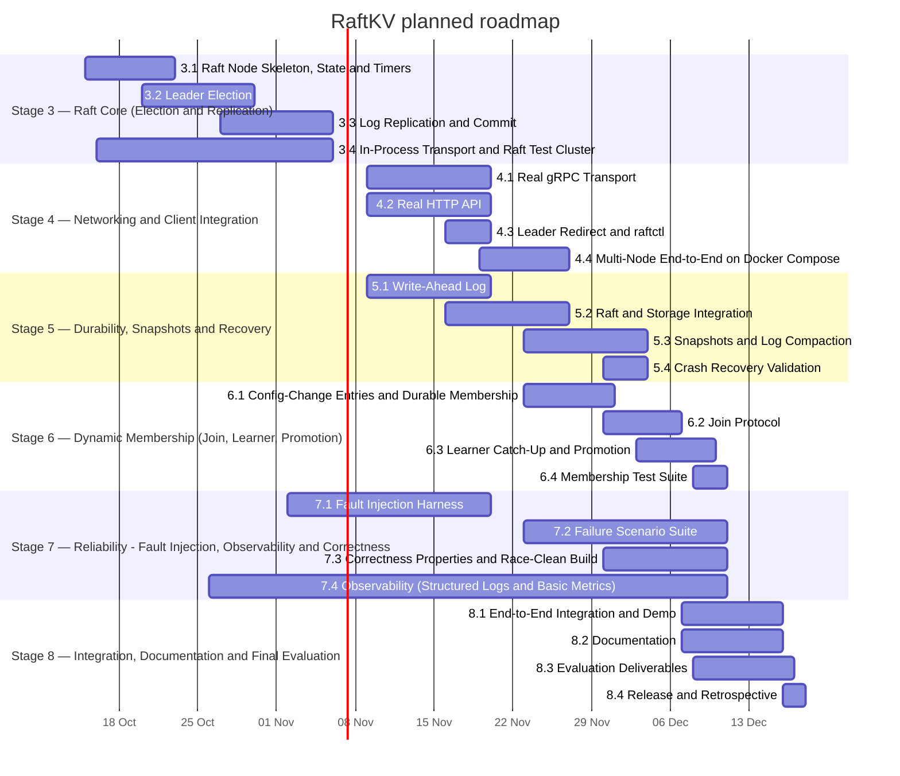

# RaftKV — Roadmap

## Implementation update — 27 October 2026

Local work now includes Stage 3.1–3.4, Stage 4's network/API/CLI code, and
Stage 5.1–5.2 WAL/durable process integration. Local tests include separate
process leader failure and full-cluster restart. Reviews and publication are
separate; this update does not mark the whole project complete.

Remaining critical path: **5.3 snapshots/compaction → remaining 5.4 recovery →
6.1–6.4 dynamic membership → 7 reliability/observability → 4.4 Compose acceptance
and 8 cluster UI/evaluation**. Stage 9 is optional post-MVP work.

See [current completion checklist](../completion-plan.md),
[etcd comparison and review additions](../raft-readiness-review.md), and
[durable node run instructions](../stage5-status.md).

Add explicit acceptance checks for atomic snapshot publication, recoverable
membership transitions, learner promotion/removal, operation histories under
faults, resource limits under quorum loss, and host/container address routing.
These clarify existing phases; the review's optional extensions are not silently
added to the MVP. The schedule below remains the original planning baseline.

> Planned schedule. **Live status lives on the GitHub Project board** (see README). This file is the static mirror of the plan so it can be read offline and cited in the report.

Sprint 1 starts **Mon 12 Oct 2026**; assumed final evaluation **Fri 18 Dec 2026**. Ten weekly sprints, aligned to the ratified SDD (sections 41-47).

## Stages

| Stage | Dates (planned) | Owner(s) | Est. hours | MUST hours | Exit criteria |
|---|---|---|---:|---:|---|
| **Stage 1 — Foundation, Interfaces & System Design** | Built (verify on board); governance close-out in Sprint 1 | Person 1, Person 2, Person 3, Person 4, Whole team | 75 | 58 | all interfaces frozen by a synchronous team review; SDD ratified; CI + branch protection active. |
| **Stage 2 — Standalone Key-Value Engine** | Built (verify on board); governance close-out in Sprint 1 | Person 1, Person 2, Person 4 | 47 | 39 | determinism + round-trip + import-boundary checks green in CI. |
| **Stage 3 — Raft Core (Election & Replication)** | 15 Oct – 06 Nov | Person 1, Person 3, Person 4 | 116 | 111 | no two leaders per term; committed entries never lost; commit only with quorum. |
| **Stage 4 — Networking & Client Integration** | 09 Nov – 27 Nov | Person 3, Person 4 | 66 | 62 | PUT via raftctl on any node replicates and is readable cluster-wide. |
| **Stage 5 — Durability, Snapshots & Recovery** | 09 Nov – 04 Dec | Person 1, Person 2 | 84 | 78 | kill -9 and full-cluster restart lose no committed data. |
| **Stage 6 — Dynamic Membership (Join, Learner, Promotion)** | 23 Nov – 11 Dec | Person 1, Person 2, Person 3, Person 4 | 74 | 69 | a 4th node joins a live cluster, catches up, is promoted, and survives restart. |
| **Stage 7 — Reliability: Fault Injection, Observability & Correctness** | 26 Oct – 11 Dec | Person 3, Person 4, Whole team | 81 | 64 | leader crash, follower crash, partition, restart scenarios pass; go test -race clean. |
| **Stage 8 — Integration, Documentation & Final Evaluation** | 07 Dec – 18 Dec | Person 2, Person 3, Person 4, Whole team | 54 | 48 | demo reproducible from README; report and deck submitted. |
| **Stage 9 — Stretch Goals (post-MVP)** | unscheduled (post-MVP) | Person 1, Person 2, Person 3, Person 4 | 50 | 0 | SHOULD/MAY items attempted only after the MVP is stable and documented (SDD sections 42-43). |

## Gantt (Stages 3-8)

## Capacity and cut line

- Remaining MVP work (Stages 3-8): **475 h** (MUST 432 h, SHOULD 43 h). Stretch (Stage 9): 50 h.
- Capacity assumed by the SDD (section 47): 4 people x ~10 h/week = 400 h raw over 10 weeks, ~300 h effective after ~25% coordination/debug overhead.
- **Gap:** the plan needs about 12 h per person per week of build time. Either the team sustains that, or the cut line below is applied. Check burn against the *Estimate (h)* field at the end of every sprint.

| Order | Cut first | Saves (approx.) | Rule |
|---|---|---:|---|
| 1 | All SHOULD / MAY items and Stage 9 | 43 h (+50 h stretch) | Never started before MUST items in the same stage are done |
| 2 | Second-wave fault scenarios (S7.2-05, S7.2-06), nightly property job (S7.3-03) | ~12 h | Keep leader crash, follower crash, partition, restart |
| 3 | Narrow property-test breadth (S7.3-01) to invariants S1, S2, S4, S7 | ~4 h | Never remove the race-detector gate |
| 4 | Escalate to instructor: reduced membership demo scope (Stage 6 is 74 h) | negotiable | **Needs instructor sign-off, not a silent cut** |
| Never cut | Election/replication correctness tests, WAL durability tests, `go test -race`, join + learner + promotion happy path | — | SDD section 47 |

## Top risks

| # | Risk | Likelihood | Impact | Mitigation |
|---|---|---|---|---|
| 1 | Capacity gap: plan needs ~12 h/person/week vs 10 assumed | High | High | Cut line above; weekly burn check; protect Person 1 during Sprints 2-4 |
| 2 | Interfaces not yet frozen (S1.2-06) blocks Stage 3 | Medium | High | Synchronous freeze review and SDD ratification are the first two items of Sprint 1 |
| 3 | Log replication and conflict resolution (S3.3) overruns | High | High | Budgeted over two sprints; teammates own test tasks so Person 1 stays on the critical path |
| 4 | Membership (Stage 6) underestimated | High | High | Do not start until Stages 3-5 are green; timebox; instructor checkpoint at end of Sprint 7 |
| 5 | Fault harness built too late to validate earlier work | Medium | High | In-process hooks in Sprint 4 (S3.4-01), full harness from Sprint 4-6 |
| 6 | Tests under-invested relative to features | Medium | High | Definition of Done requires failure tests; PR template enforces it |
| 7 | Report/presentation time underestimated | Medium | Medium | Stage 8 is explicit; ADRs written incrementally with each PR |
| 8 | Scope creep toward etcd-like features | Medium | Medium | OUT_OF_SCOPE list pinned (S1.7-04); Stage 9 clearly separated |
